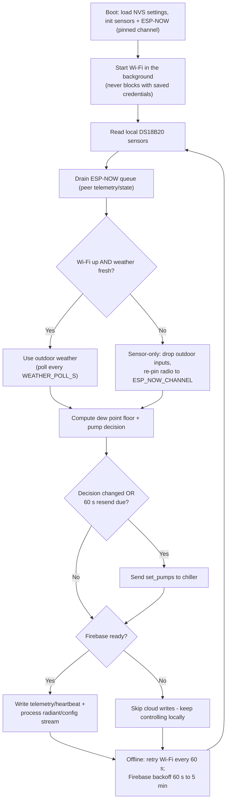
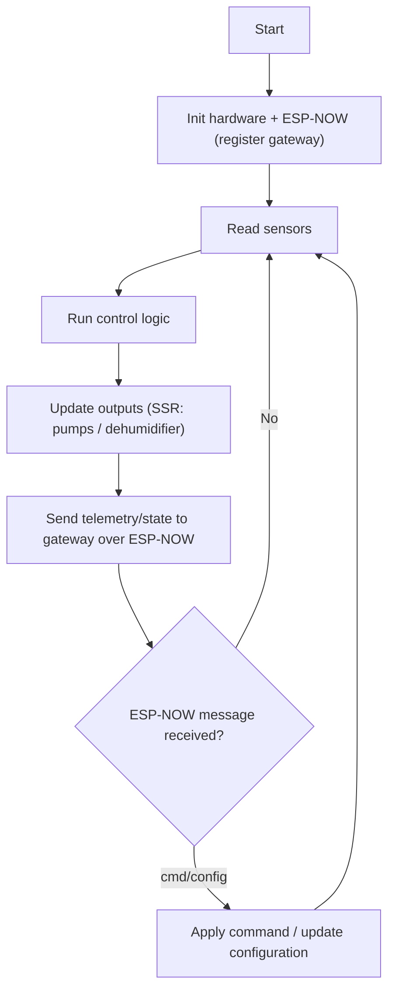
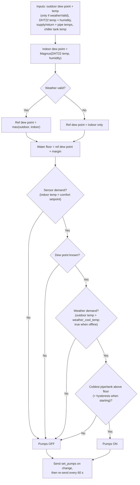
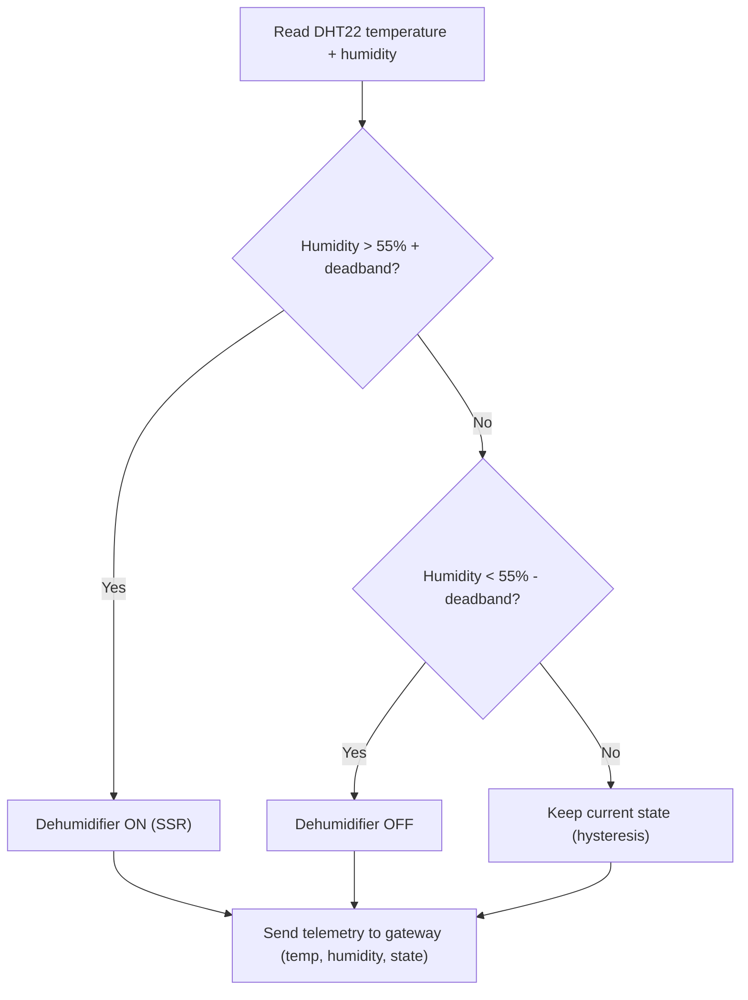

# Flow Charts

> Control logic flows for the ESP32 firmware — matches the implemented code
> in `src/esp/` (the pump decision lives in `ClimateControl.cpp`).

## 1. Main Control Loops

The three boards are split into two roles: the **gateway** (`RadiantCoolingMonitor`, the only board with Wi-Fi + Firebase) and the **ESP-NOW peers** (`WaterChillerController`, `DehumidifierController`).

### 1a. Gateway loop (`RadiantCoolingMonitor`)

### 1b. Peer loop (`WaterChillerController`, `DehumidifierController`)

## 2. Water Pump Control Logic (computed on the gateway)

The pump decision is **not** made on the chiller board — the gateway
(`RadiantCoolingMonitor`) computes it from the available weather and all ESP
sensor readings, then sends a `set_pumps` command to the chiller. Weather is
optional: with no Wi-Fi/internet the gateway runs the same algorithm in
**sensor-only** mode. The chiller board only executes commands (with a local
fail-safe: pumps off if its water sensor is lost).

> Thresholds (tunable via `config/control` in Firebase): comfort setpoint
> 24 °C, dew-point margin 2 °C, weather demand above 28 °C, hysteresis 1 °C.
> They are cached in NVS so an offline reboot keeps them. Hysteresis is
> applied by comparing against the floor ± margin depending on whether the
> pumps are already running. With no valid dew point (or no valid pipe/tank
> temperature) the decision is **OFF** (fail-safe).

## 3. Dehumidifier Control Logic

`DehumidifierController` — holds indoor relative humidity at the **55%**
setpoint (read from its own DHT22), with hysteresis. The humidity reading is
also sent to the gateway for the chiller dew-point computation.

> Setpoint 55 %RH, deadband 5 %RH by default (tunable via `config/dh`).

## Notes

- Hysteresis (deadbands) is applied to all switching logic to prevent SSR
  chatter and short-cycling of the pumps/dehumidifier.
- **Offline:** no WeatherAPI and no Firebase traffic. Pump control uses only
  the sensors; if the dew point is unavailable the pumps are held off. Peer
  telemetry still arrives over ESP-NOW, so the display/state stays live on
  the local gateway.
- **Fail-safe behaviour:** per-controller local guards sit below these flows
  (chiller: water-sensor loss → pumps off; dehumidifier: 3 failed DHT22
  reads → output off; gateway: unknown dew point/cold point → pumps off).
