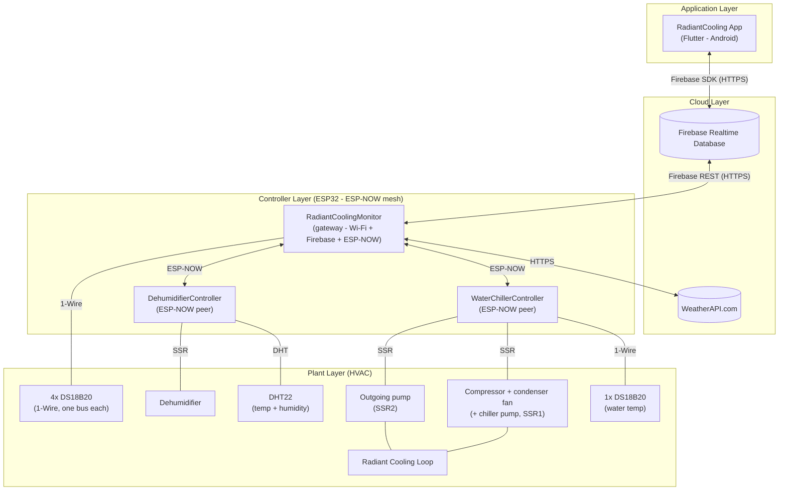

# System Architecture

> High-level view of the Radiant Cooling System: the Flutter app, Firebase
> Realtime Database, the ESP32 mesh (ESP-NOW), and the physical HVAC plant.

## Overview

The system is organized into four logical layers:

| Layer          | Components                                              | Responsibility                                |
| -------------- | ------------------------------------------------------- | --------------------------------------------- |
| Application    | `RadiantCooling` Flutter app (Android)                   | Monitoring, configuration, user interface     |
| Cloud          | Firebase Realtime Database + WeatherAPI.com               | **Optional** shared data store; outdoor dew point when available |
| Controllers    | ESP32 — `RadiantCoolingMonitor` (**gateway**), `WaterChillerController`, `DehumidifierController` | Local control loops, sensing, actuation |
| Plant          | Compressor + condenser fan + chiller pump (SSR1), outgoing pump (SSR2), dehumidifier (SSR), DS18B20 + DHT22 sensors | Physical HVAC equipment |

**Key point:** the three ESP32 boards talk to each other over **ESP-NOW**
(no router or broker needed). Only `RadiantCoolingMonitor` connects to
Wi-Fi and Firebase, acting as the (optional) gateway between the mesh and
the cloud. The controller layer is self-sufficient: with no router,
internet, Firebase or WeatherAPI, the gateway keeps running its
sensor-only control loop and reconnects to the cloud automatically.

## Diagram

## Data flows

- **Sensors → app:** every board reads its own sensors (gateway: 6x
  DS18B20; chiller: 1x DS18B20; dehumidifier: 1x DHT22). Peers send their
  readings to the gateway over ESP-NOW; the gateway combines everything and
  writes to Firebase; the app reads via the Firebase SDK.
- **Weather → control (online):** the gateway polls WeatherAPI.com (API key
  managed by the app and delivered via `radiant/config/weather_key`) for the
  outdoor dew point/temperature and computes the chiller pump decision
  (weather + sensors + condensation protection, see
  `docs/diagrams/flow-chart.md`).
- **Sensors → local control (offline):** when Wi-Fi/weather is unavailable
  the gateway ignores outdoor inputs, uses the indoor DHT22 dew point as the
  condensation reference, and keeps the pumps running on indoor demand (or
  holds them off if the dew point is unknown). No cloud traffic is attempted.
- **App → plant:** the app writes `config`/`cmd` in Firebase; the gateway
  detects the change and relays it to the right peer over ESP-NOW.
- **Reconnect:** when Wi-Fi returns, the gateway refreshes weather
  immediately, re-initialises Firebase with backoff, and resumes telemetry +
  config streaming. NVS retains the last tunable settings across an offline
  power cycle.

- **Manual outputs:** in manual mode the dashboard writes `compressor`
  (SSR1: compressor + condenser fan + chiller pump) and `outgoing_pump`
  (SSR2) independently; auto mode keeps both outputs on the computed
  `set_pumps` path.

## Notes

- **Single Wi-Fi channel, with an offline pin:** all boards must share one
  channel for ESP-NOW. While associated the gateway follows the router; when
  the AP is lost it re-pins the radio to `ESP_NOW_CHANNEL` so the mesh keeps
  working. A router on a different channel cannot reach the gateway, which
  fails safe (pumps off) until it is corrected.
- The gateway buffers ESP-NOW packets in a FreeRTOS queue and writes to
  Firebase asynchronously — never inside the ESP-NOW callback. The cloud task
  is idle (no TLS at all) while Wi-Fi is down.
- Interfaces between controllers and plant equipment are detailed in the
  block diagram and schematics.
